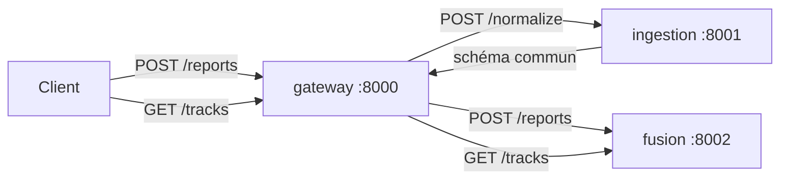

# MSI-Fusion — Multi-source information fusion with micro-services


Démonstrateur d'architecture **micro-services** pour la **fusion d'informations multi-sources** (radar, imagerie, OSINT) : des rapports hétérogènes sont normalisés, puis corrélés en **pistes (tracks)** uniques avec un score de confiance.

> Projet pédagogique sur données **synthétiques**. Il illustre des choix d'architecture, pas un système opérationnel.

## Architecture



| Service | Responsabilité |
|---|---|
| `gateway` | Point d'entrée unique, orchestre le pipeline (httpx, async) |
| `ingestion` | Un adaptateur par source (radar / imint / osint), fiabilité a priori, validation des payloads |
| `fusion` | Association des rapports en pistes, position pondérée, confiance combinée |

### Algorithme de fusion

1. **Gating spatio-temporel** : un rapport est rattaché à une piste de même label si la distance (Haversine) est ≤ 5 km et l'écart temporel ≤ 10 min ; sinon une nouvelle piste est créée. Seuils configurables.
2. **Position fusionnée** : moyenne pondérée par `fiabilité de la source × confiance du rapport`.
3. **Confiance de la piste** : combinaison *noisy-OR* de supports indépendants, `1 − Π(1 − wᵢ)` (cas simple de la théorie de Dempster-Shafer). Elle augmente avec le nombre de sources concordantes.

### Choix d'architecture

- **Un service par responsabilité** : ajouter une source = un adaptateur dans `ingestion`, sans toucher à la fusion.
- **Schéma commun** entre services : `source, reliability, lat, lon, timestamp, confidence, label`.
- **Moteur de fusion pur** (`fusion.py`), sans I/O, testable unitairement.
- **Santé et démarrage ordonné** : `/health` sur chaque service, `depends_on` avec healthcheck dans Docker Compose.

### Limites connues et évolutions

| Limite actuelle | Évolution envisagée |
|---|---|
| HTTP synchrone entre services | Broker de messages (Kafka / RabbitMQ), traitement asynchrone |
| Pistes en mémoire | Stockage persistant (PostgreSQL / PostGIS) |
| Association par seuils (gating) | Filtre de Kalman, association de données (GNN / JPDA) |
| Confiance noisy-OR | Dempster-Shafer complet, gestion des sources conflictuelles |
| Pas d'authentification | Authn/authz entre services, traçabilité et audit des accès |

## Lancer

```bash
docker compose up --build
python scripts/demo.py          # envoie un scénario multi-sources à la gateway
```

Sans Docker : lancer chaque service avec `uvicorn main:app --port <port>` depuis son dossier
(`INGESTION_URL` et `FUSION_URL` pour la gateway).

### Exemple de sortie de `scripts/demo.py`

```
radar  -> track 5f774d9c (vessel-A) n=1 conf=0.72
imint  -> track 5f774d9c (vessel-A) n=2 conf=0.899
osint  -> track 5f774d9c (vessel-A) n=3 conf=0.929
radar  -> track e97a8918 (vessel-B) n=1 conf=0.54
osint  -> track cf8e2610 (vessel-A) n=1 conf=0.2
```

Trois sources concordantes sur `vessel-A` fusionnent en une seule piste (confiance 0.72 → 0.929) ; `vessel-B` est une piste séparée ; le rapport OSINT isolé, trop ancien, ouvre une nouvelle piste.

### Appel manuel

```bash
curl -X POST localhost:8000/reports -H 'content-type: application/json' -d '{
  "source":"osint","payload":{"location":{"lat":48.81,"lon":2.21},
  "published":"2026-11-05T12:02:00Z","label":"vessel-A","credibility":0.6}}'
curl localhost:8000/tracks
```

## Tests

```bash
pip install pytest fastapi httpx
pytest -q        # 13 tests : moteur de fusion, normalisation, API ingestion et fusion
```

## Structure

```
services/{gateway,ingestion,fusion}/   code + Dockerfile de chaque service
tests/                                 tests unitaires et d'API
scripts/demo.py                        scénario de démonstration
docker-compose.yml                     orchestration locale
.github/workflows/ci.yml               tests + build des images
```

## Auteure

Emna Khelifi — élève ingénieure ENSI (IA & Data Science).
